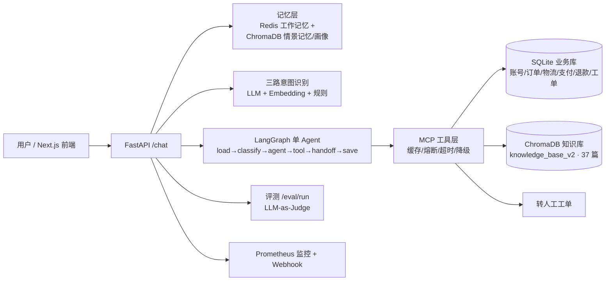

# Salvo — 企业级智能客服 Agent 平台

Salvo 是一个面向**电商售后场景**的智能客服 Agent 平台。它以 LangGraph 受控单 Agent 为核心，把「意图识别 → 记忆上下文 → Agent 推理 → 工具调用（业务库 / RAG 知识库）→ 转人工工单 → 监控反馈 → 自动评测」串成完整闭环，并提供独立的前端控制台与 Docker 一键部署。

> 定位说明：当前实现的是**受控单 Agent（ReAct 循环 + 工具调用）**，而非自治式多 Agent 协作；业务复杂度通过意图路由、任务白名单和工具集收敛，更贴近企业客服的真实可控性要求。

---

## 核心能力

- **LangGraph 受控 Agent Runtime**：`load_state → classify_or_resume → agent → tool → handoff → save_state` 六节点图，支持多轮工具调用、条件循环、人工升级判定与会话状态持久化。
- **三路融合意图识别**：LLM 语义理解 + Embedding 相似度 + 关键词规则并行打分后投票，输出意图类别、紧急度和实体抽取。
- **RAG 知识库检索**：ChromaDB 存储 37 篇电商售后文档（9 个知识域），支持 metadata 过滤、有效期限定；检索链路包含**向量 + BM25 混合召回（RRF 融合）**与**查询改写 → 并行召回 → 去重 → 重排**完整管线。
- **业务工具层（MCP）**：12 个真实工具，覆盖账号、订单、物流、支付、退款政策、退款资格、退款申请、故障公告、人工工单等售后链路；带缓存、熔断、超时、降级与参数校验。
- **分层记忆**：Redis 保存工作记忆（会话状态 + 最近消息 + 摘要压缩），ChromaDB 保存情景记忆与用户画像，支持长期语义召回。
- **监控与闭环反馈**：Prometheus 指标 + 阈值告警 + Webhook 通知，基于工具成功率/延迟动态生成路由惩罚与优化建议。
- **自动评测体系**：检索层评测（Recall / Precision / MRR / NDCG）+ 端到端对话评测（LLM-as-Judge），报告落盘、可对比。
- **前端控制台**：Next.js 实现对话工作台、知识库管理、评测实验室、监控中心、Skills 管理五个页面。
- **工程化部署**：多阶段 Dockerfile（生产/开发镜像）、Docker Compose 编排（应用 + ChromaDB + Redis + Prometheus + 前端 + Nginx）、国内 PyPI 镜像加速、ONNX 模型运行时挂载。

---

## 架构总览



## 技术栈

| 层 | 技术 |
|---|---|
| 后端 | Python 3.12 · FastAPI · LangGraph · Anthropic 兼容 API |
| 数据 | Redis 7 · ChromaDB 0.5.23 · SQLite |
| 检索 | ChromaDB 向量 · 自研纯 Python BM25 · RRF 融合 |
| 前端 | Next.js · TypeScript · Tailwind |
| 可观测 | Prometheus · Webhook 告警 |
| 部署 | Docker / Docker Compose · Nginx |

---

## 快速开始

### 1. 准备环境变量

在项目根目录创建 `.env`，最小配置如下：

```dotenv
ANTHROPIC_API_KEY=sk-xxx          # Anthropic 兼容 API Key
ANTHROPIC_MODEL=deepseek-v4-flash # 兼容 DeepSeek 等模型
ANTHROPIC_BASE_URL=https://api.deepseek.com/anthropic
REDIS_PASSWORD=echomind123
```

### 2. 构建并启动

```bash
docker compose up -d --build
```

首次启动会自动拉起 6 个服务：`echomind`（API）、`chromadb`、`redis`、`prometheus`、`frontend`、`nginx`。

### 3. 初始化电商售后知识库（首次必需）

```bash
docker compose run --rm --no-deps echomind \
  python3 -m integrations.knowledge_base.init_knowledge --host chromadb --port 8000
```

该命令将 `data/knowledge/after_sales_v2.json` 中 37 篇文档导入 `knowledge_base_v2` collection。

### 4. 访问入口

| 入口 | 地址 |
|---|---|
| 前端控制台 | http://localhost:3000 |
| API / 健康检查 | http://localhost:8000/health |
| FastAPI 文档 | http://localhost:8000/docs |
| Prometheus | http://localhost:9090 |

---

## 核心模块

### 主链路（`api/main.py`）

`/chat` 接收用户消息后：读取记忆上下文 → 意图识别 → 进入 LangGraph Runtime → Agent 按需调用业务工具或知识库工具 → 必要时创建人工工单 → 返回回复、轨迹（trace）与元信息。

### Agent Runtime（`agents/runtime.py`）

基于 LangGraph Graph API 的受控 ReAct 循环：

- 按任务类型加载会话状态、选择工具白名单；
- `agent_node` 决策动作（调用工具 / 追问槽位 / 回答 / 转人工）；
- `tool_node` 通过 MCP 工具层执行并写回观察结果；
- `handoff_node` 判定人工升级条件并创建工单；
- `save_state` 持久化会话状态，循环上限 4 轮。

### RAG 知识库（`mcp/knowledge_base.py` + `mcp/retrieval_hybrid.py`）

- 37 篇电商售后文档（退款/退货/换货/物流/优惠券/发票/工单/故障/合规），metadata 完整（doc_id、category、product、有效期、政策编码等）；
- 混合检索：ChromaDB 向量召回 + 自研 BM25 关键词召回，RRF 融合排序，零第三方检索依赖；
- 完整管线：查询改写（LLM）→ 并行召回 → 去重 → 重排（LLM，失败自动降级且不截断候选）→ Top-K；
- metadata 过滤与有效期限定（`effective_from/effective_to` 自动生效），过期公告不会进入结果；
- 一致性校验：知识库政策数值与业务库 `refund_policies` / `incidents` 表自动比对（`integrations/knowledge_base/consistency_check.py`）。

### 业务工具（`mcp/business_tool_handlers.py` + `integrations/business_db/`）

SQLite 电商售后 v2 数据模型（账号、订单、物流、支付、退款申请、退换货、优惠券补偿、故障公告、工单、审计日志），12 个工具全部可被 Agent 调用：

`knowledge_search` · `account_status_lookup` · `order_lookup` · `order_items_lookup` · `shipment_tracking_lookup` · `payment_attempt_lookup` · `refund_policy_lookup` · `refund_eligibility_check` · `create_refund_request` · `refund_request_lookup` · `incident_lookup` · `create_handoff_ticket`

### 记忆系统（`memory/conversation_memory.py`）

- **工作记忆**：Redis，保存会话消息、槽位、任务状态，超长自动摘要压缩；
- **情景记忆**：ChromaDB `episodic` collection，按语义召回历史对话片段；
- **用户画像**：ChromaDB `user_profile` collection，从对话中抽取并更新。

### 监控（`monitor/performance_monitor.py`）

周期采集 Agent / 工具运行指标，异常检测（窗口 + 灵敏度），阈值告警 + Webhook，并基于成功率与延迟生成路由惩罚建议。

### 评测（`evaluation/`）

- `customer_support_eval_v1.jsonl`：20 条端到端客服对话用例，LLM-as-Judge 评分（`run_eval.py`）；
- `rag_retrieval_eval_v1.json`：35 条检索用例，覆盖 9 个知识域，计算 Recall@k / Precision@k / MRR / NDCG / 过滤合规率（`run_rag_retrieval_eval.py`，支持 direct / hybrid / rewrite 三种模式与改前改后对比）；
- 报告输出到 `evaluation/reports/`，JSON + Markdown 双格式。

### 前端（`frontend/`）

Next.js App Router 五个页面：`/` 对话工作台、`/knowledge` 知识库管理（按知识域/产品过滤检索）、`/eval` 评测实验室、`/monitor` 监控中心、`/skills` Skills 管理。

### Skills 热加载（`core/skill_loader.py`）

业务能力说明按目录组织，启动加载、运行时可热重载，动态注入 Agent 提示词。

---

## RAG 检索评测结果

同一数据集（35 条用例，top_k=5，无过滤）三种检索模式对比：

| 指标 | direct（纯向量） | hybrid（向量+BM25+RRF） | rewrite（改写+并行召回+重排） |
|---|---|---|---|
| Recall@5 | 0.3143 | 0.6571 | **0.7429** |
| Precision@5 | 0.0743 | 0.1543 | **0.1900** |
| MRR | 0.2881 | **0.4971** | 0.3871 |
| NDCG@5 | 0.2706 | **0.5114** | 0.4502 |

结论：混合检索相比纯向量检索在召回和排序上全面大幅提升；加入查询改写与并行召回后召回覆盖进一步提升（0.66 → 0.74），但 LLM 重排的排序质量仍待优化（下一步可引入 cross-encoder 重排）。

复现命令：

```bash
docker compose run --rm --no-deps -v $PWD/evaluation:/app/evaluation echomind \
  python3 -m evaluation.run_rag_retrieval_eval --mode hybrid --no-filters
docker compose run --rm --no-deps -v $PWD/evaluation:/app/evaluation echomind \
  python3 -m evaluation.run_rag_retrieval_eval --mode rewrite --no-filters
```

---

## API 一览

| 方法 | 路径 | 说明 |
|---|---|---|
| POST | `/chat` | 主对话链路（Agent） |
| GET | `/health` | 健康检查 |
| GET | `/metrics` | Prometheus 指标 |
| GET | `/monitor` | 监控摘要 |
| POST | `/search` | 知识库检索（带查询改写） |
| POST | `/knowledge/search` | 知识库过滤检索 |
| POST | `/knowledge/add` `/knowledge/upload` | 知识入库 / 文件上传入库 |
| GET | `/knowledge/stats` | 知识库统计 |
| GET/POST | `/skills` `/skills/reload` | Skills 查询 / 热重载 |
| POST | `/eval/run` | 运行端到端评测 |

---

## 目录结构

```text
Salvo/
├── api/                    # FastAPI 入口、工具注册、/chat 主链路
├── agents/                 # LangGraph Runtime、会话状态、编排器
├── core/                   # 意图识别、LLM 兼容工具、Skills 加载
├── mcp/                    # 工具管理器（缓存/熔断/降级）、RAG、业务工具
├── integrations/           # SQLite 业务库、知识库初始化与一致性校验
├── memory/                 # Redis + ChromaDB 分层记忆
├── monitor/                # Prometheus 指标与告警
├── evaluation/             # 评测数据集、脚本、报告
├── frontend/               # Next.js 控制台
├── skills/                 # 业务 Skills 定义
├── data/                   # ChromaDB、SQLite、知识库文档、ONNX 模型缓存
├── docs/                   # 架构与方案文档
└── config/                 # Prometheus、Nginx 配置
```

## 相关文档

- [架构总览](docs/echomind-architecture-summary.md)
- [LangGraph 单 Agent 设计](docs/echomind-langgraph-single-agent-design.md)
- [RAG 知识库建设方案](docs/echomind-rag-knowledge-inventory.md)
- [电商售后二期数据库方案](docs/echomind-ecommerce-phase2-plan.md)
- [Agent 升级路线图](docs/echomind-agent-upgrade-roadmap.md)

## 后续规划

- cross-encoder 重排 + 相关性阈值 + 引用溯源（RAG Phase B 第 3 项）
- 生成层 / 端到端三层评测与回归门槛（Phase C）
- 核心模块单元测试与 CI（pytest + GitHub Actions）
- 文档版本管理、badcase 回流与告警（Phase D）
